

  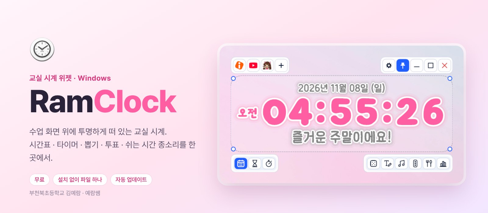

  <a href="https://github.com/dpfkadpfka/RamClock/releases/latest/download/RamClock.exe"><b>RamClock.exe 내려받기</b></a>
  &nbsp;·&nbsp; <a href="https://github.com/dpfkadpfka/RamClock/releases/latest">최신 릴리스</a>
  &nbsp;·&nbsp; <a href="CHANGELOG.md">바뀐 점</a>
  &nbsp;·&nbsp; <a href="https://dpfkadpfka.github.io/">예람쌤 홈페이지</a>

Windows 10 · 11 &nbsp;|&nbsp; 무료 &nbsp;|&nbsp; 파일 하나로 실행 &nbsp;|&nbsp; 새 버전은 자동 업데이트

---

## 01 · RamClock 소개
수업 화면을 가리지 않는 교실 시계

RamClock은 교실 컴퓨터 화면 위에 투명하게 떠 있는 시계 위젯이에요. 글씨와 숫자만 보이고 배경은 비쳐서, PPT나 영상 위에 올려 두어도 수업을 가리지 않아요. 지금 몇 교시인지, 쉬는 시간까지 얼마나 남았는지를 함께 보여 줘요.

 그림 1 · 실제 교실 컴퓨터에서 실행한 모습 (기본 디자인 ‘벚꽃 핑크’)

### 이런 걸 할 수 있어요

| 기능 | 내용 |
|---|---|
| 시간표 · 타이머 · 스톱워치 | 지금 교시와 남은 시간, 거꾸로 세기, 걸린 시간 재기 |
| 쉬는 시간 종소리 | 수업이 끝나면 학교 종소리 9가지 중 하나로 알려 줘요 |
| 선생님 안내 | “조용히”, “선생님 보세요” 같은 안내를 크게 띄우고 읽어 줘요 |
| 뽑기 | 우리 반 번호 카드에서 한 명을 골라 크게 보여 줘요 |
| 투표 · 의견 모으기 | QR을 띄우면 학생이 태블릿으로 답하고, 결과가 바로 올라와요 |
| 주간 시간표 | 주간학습안내(PDF·한글)를 넣으면 그 주 과목과 내용을 읽어 와요 |
| 텍스트 메모 · 급식 · 생일 | 시계 아래 준비물 메모, 오늘 점심 메뉴, 생일 축하 안내 |
| 소음 신호등 · 음악 | 교실 소리를 신호등으로 보여 주고, 유튜브 미니 플레이어도 있어요 |
| 업데이트 | 새 버전이 나오면 알아서 받아 두고 바꿔요 |

> [!TIP]
> 명단·시간표·설정은 이 컴퓨터에만 저장돼요. 인터넷에 올라가지 않아요. (투표·학생 카드처럼 학생 태블릿과 주고받는 기능만 그때그때 연결해요.)

### 차례

| | 주제 | 다루는 것 |
|---|---|---|
| 02 | [설치하기](#02--설치하기) | 파일 받기 · 경고 창 넘기기 |
| 03 | [처음 설정](#03--처음-설정) | 시정표 · 시간표 · 명단 · 도구 고르기 |
| 04 | [화면 둘러보기](#04--화면-둘러보기) | 버튼 네 묶음 |
| 05 | [시간표 · 타이머 · 스톱워치](#05--시간표--타이머--스톱워치) | 모드 바꾸기 |
| 06 | [선생님 안내](#06--선생님-안내) | 안내 띄우기 · 닫기 · 만들기 |
| 07 | [쉬는 시간 종소리](#07--쉬는-시간-종소리) | 종소리 9가지 · 켜고 끄기 |
| 08 | [뽑기](#08--뽑기) | 명단 넣기 · 골고루 뽑기 |
| 09 | [투표 · 의견 모으기](#09--투표--의견-모으기) | QR 투표 · 의견 쪽지 · 의견 뽑기 |
| 10 | [주간 시간표](#10--주간-시간표) | 주간학습안내 불러오기 |
| 11 | [텍스트 메모 · 급식](#11--텍스트-메모--급식) | 메모 꾸미기 · 오늘 급식 |
| 12 | [생일 축하](#12--생일-축하) | 생일 안내 · 생일 달력 |
| 13 | [소음 신호등 · 음악](#13--소음-신호등--음악) | 소리 재기 · 미니 플레이어 |
| 14 | [디자인 꾸미기](#14--디자인-꾸미기) | 테마 · 글꼴 · 효과 · 앱 아이콘 |
| 15 | [업데이트 · 바뀐 점](#15--업데이트--바뀐-점) | 새 버전 받기 · 버전 기록 |
| 16 | [자주 묻는 질문](#16--자주-묻는-질문) | 경고 창 · 소리 · 화면 |

---

## 02 · 설치하기
파일 하나만 받아 실행하면 끝

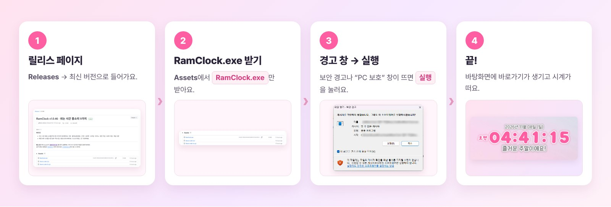 그림 2 · 설치 따라 하기

1. **릴리스 페이지로 가기** — 이 페이지 오른쪽 **Releases**를 누르거나 [최신 릴리스](https://github.com/dpfkadpfka/RamClock/releases/latest)로 들어가요.
2. **RamClock.exe 받기** — 아래 **Assets**에서 빨간 칸의 `RamClock.exe`만 받으면 돼요. (Source code는 받지 않아도 돼요)
3. **실행하기** — 받은 파일을 두 번 눌러요. 경고 창이 뜨면 아래처럼 넘겨요.
4. **끝** — 처음 켜질 때 프로그램이 스스로 제자리(`내 PC의 프로그램 폴더\RamClock`)로 옮겨 가고, **바탕화면과 시작 메뉴에 RamClock 바로가기**를 만들어요. 다운로드 폴더에 남은 파일은 지워져요.

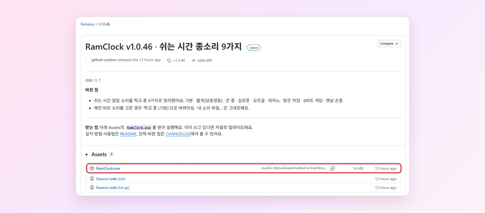 그림 3 · 릴리스 페이지 — Assets의 <code>RamClock.exe</code>(빨간 칸)만 받아요

### 경고 창이 뜰 때

개인이 만든 무료 앱이라 윈도우가 “게시자를 확인할 수 없다”고 알려 주는 거예요. 컴퓨터 설정에 따라 둘 중 하나가 떠요.

| 이런 창이 뜨면 | 이렇게 |
|---|---|
| **파일 열기 - 보안 경고** (그림 4) | **[실행]** 을 눌러요. |
| 파란 **Windows의 PC 보호** | **추가 정보** 글자를 누르면 아래에 **[실행]** 버튼이 생겨요. 그걸 눌러요. |

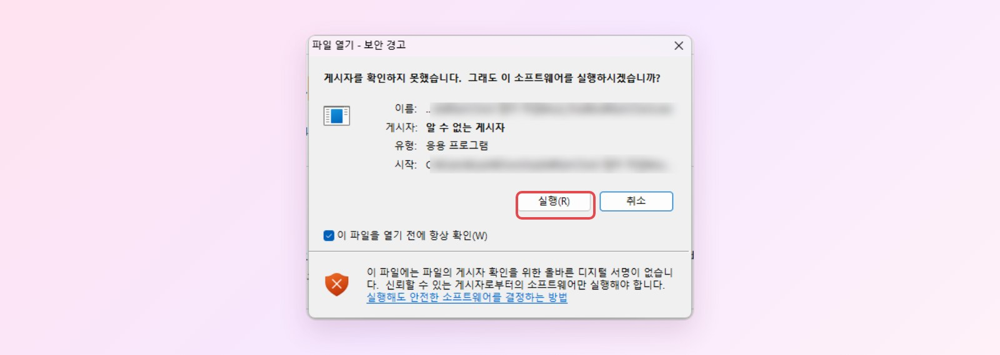 그림 4 · 학교 컴퓨터에서 뜬 ‘파일 열기 - 보안 경고’ 창 — 빨간 칸의 [실행]

> [!NOTE]
> 경고 창은 처음 한 번만 떠요. 다음부터는 바탕화면의 **RamClock** 바로가기로 켜요.

> [!IMPORTANT]
> 학교 컴퓨터 보안 프로그램이 실행을 막으면, 담당 선생님께 `RamClock.exe` 실행 허용을 부탁해 주세요.

---

## 03 · 처음 설정
우리 학교 시간에 맞추기 — 시계의 ⚙ 버튼

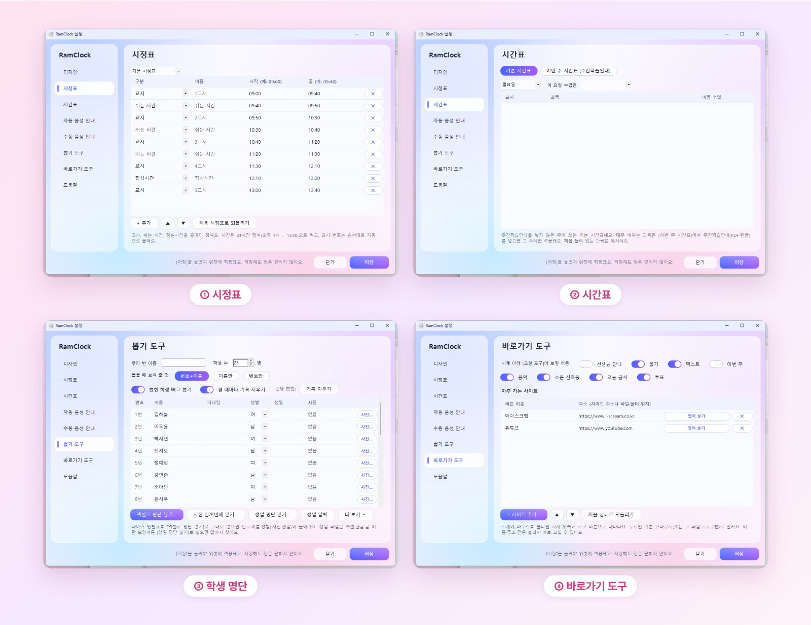 그림 5 · 설정 창 — 시정표 · 시간표 · 학생 명단 · 바로가기 도구 (화면의 명단은 예시예요)

| 순서 | 메뉴 | 할 일 |
|---|---|---|
| ① | **시정표** | 교시별 시작·끝 시간과 점심시간을 우리 학교에 맞춰요. `0945`처럼 숫자만 써도 9:45로 바뀌어요. 요일마다 몇 교시까지인지도 정해요. |
| ② | **시간표** | 요일별 기본 과목을 넣어요. 매주 바뀌면 [10 · 주간 시간표](#10--주간-시간표)로 주간학습안내를 넣어요. |
| ③ | **뽑기 도구** | 나이스 명렬표 엑셀을 **[엑셀로 명단 넣기]** 로 그대로 넣으면 번호·이름·성별(사진·생일)까지 들어가요. |
| ④ | **바로가기 도구** | 시계 아래에 보일 교실 도구를 고르고, 자주 가는 사이트를 버튼으로 붙여요. |

> [!TIP]
> 설정은 **[저장]** 을 눌러야 시계에 적용돼요. **디자인** 메뉴의 **윈도우 켤 때 자동 실행** 을 켜 두면 매일 아침 저절로 켜져요.

---

## 04 · 화면 둘러보기
마우스를 올리면 버튼이 나타나요

 그림 6 · 시계에 마우스를 올린 모습 (실제 교실 컴퓨터)

| 번호 | 자리 | 버튼 |
|---|---|---|
| 1 | 왼쪽 위 | **자주 가는 사이트** — 눌러서 바로 열기, **+** 로 추가 |
| 2 | 오른쪽 위 | **설정 · 항상 위에 두기 · 숨기기 · 크게 보기 · 끄기** |
| 3 | 왼쪽 아래 | **모드** — 시간표 · 타이머 · 스톱워치 |
| 4 | 오른쪽 아래 | **교실 도구** — 선생님 안내 · 뽑기 · 텍스트 · 이번 주 · 음악 · 소음 신호등 · 급식 · 투표 (보일 것만 골라요) |

- **옮기기** 시계를 잡고 끌어요. **크기** 네 모서리의 동그라미를 끌거나 마우스 휠을 돌려요.
- 버튼에 마우스를 잠시 올리면 무슨 버튼인지 설명이 떠요.
- 시계를 **오른쪽 클릭** 하면 숨기기 · 설정 · 업데이트 확인 · 종료 메뉴가 나와요.

---

## 05 · 시간표 · 타이머 · 스톱워치
왼쪽 아래 세 버튼으로 바꿔요

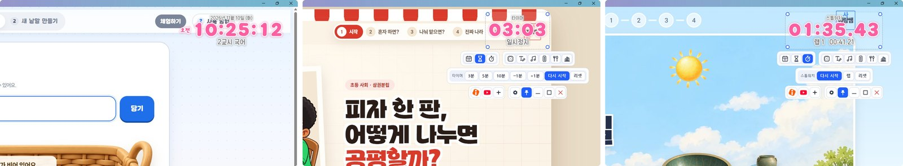 그림 7 · 시간표 · 타이머 · 스톱워치

| 모드 | 할 수 있는 것 |
|---|---|
| 시간표 | 지금 교시 · 과목, 쉬는 시간 · 점심시간까지 남은 시간 |
| 타이머 | 3분 · 5분 · 10분 바로 고르기, −1분 / +1분, 끝나면 소리로 알림 |
| 스톱워치 | 시작 · 멈춤 · 랩 · 리셋 |

> [!TIP]
> 타이머와 스톱워치는 시계를 숨겨도 계속 흘러가요.

---

## 06 · 선생님 안내
자주 하는 말을 버튼 하나로

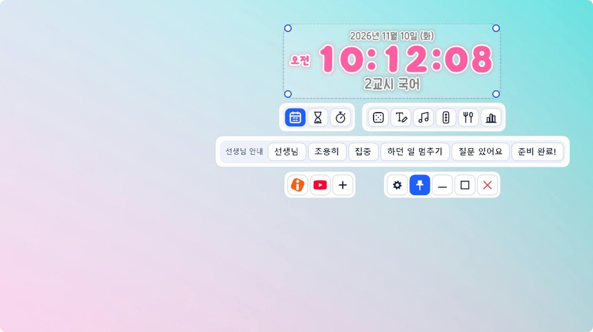 그림 8 · 안내 목록에서 고르면 크게 띄우고 읽어 줘요

- **선생님 안내** 버튼을 누르면 미리 만든 안내 목록이 나와요. 누르면 시계 아래에 크게 뜨고 소리로 읽어 줘요.
- 안내 글상자는 클릭해도 닫히지 않아요. 마우스를 올리면 오른쪽 위에 나오는 **✕** 로 닫아요.
- 안내 문구는 **설정 → 수동 음성 안내** 에서 고쳐요. 소리 파일(mp3 · wav)을 넣거나 직접 녹음할 수도 있어요.
- 정한 시각에 저절로 나오는 안내는 **설정 → 자동 음성 안내** 에서 만들어요.

---

## 07 · 쉬는 시간 종소리
수업이 끝나면 학교 종이 울려요

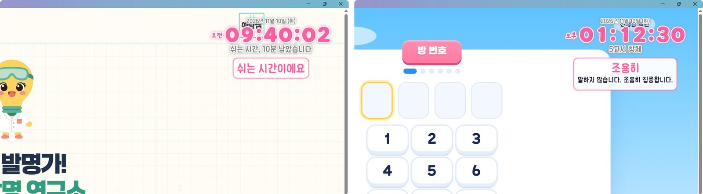 그림 9 · 쉬는 시간 화면 안내와 설정 위치

**설정 → 자동 음성 안내** 맨 위의 **쉬는 시간 시작 알림** 을 켜고, 종소리를 골라 **▶ 듣기** 로 들어 봐요.

| | 종소리 | | 종소리 |
|---|---|---|---|
| 1 | 학교 종 (기본) | 6 | 학교 종 피아노 |
| 2 | 학교 종 짧게 (딩동댕동) | 7 | 학교 종 맑은 차임 |
| 3 | 학교 종 큰 종 | 8 | 학교 종 8비트 게임 |
| 4 | 학교 종 실로폰 | 9 | 옛날 손종 (땡땡땡) |
| 5 | 학교 종 오르골 | + | 내 소리 파일… |

- 화면 안내가 필요 없으면 **화면에도 “쉬는 시간이에요” 띄우기** 를 꺼요.
- 시정표의 수업 끝 시간에 맞춰 울리고, 주말에는 울리지 않아요.

---

## 08 · 뽑기
발표자 · 모둠 뽑기

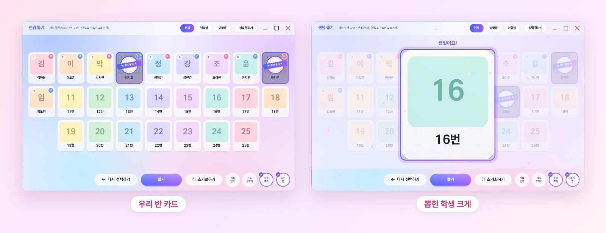 그림 10 · 우리 반 카드와 뽑힌 학생 (화면의 이름은 예시예요)

- 뽑힌 학생은 흐리게 표시돼서 골고루 뽑을 수 있어요. **뽑힌 학생 빼고 뽑기** 로 바꿀 수 있어요.
- 학생이 태블릿으로 자기 카드(사진 · 닉네임)를 꾸미는 **학생 카드** 도 있어요. 뽑기 창 오른쪽 아래 **카드 꾸미기** 버튼으로 QR을 띄워요.
- 북소리 · 빵빠레 효과음은 설정에서 끌 수 있어요.

---

## 09 · 투표 · 의견 모으기
학생 태블릿으로 바로 참여

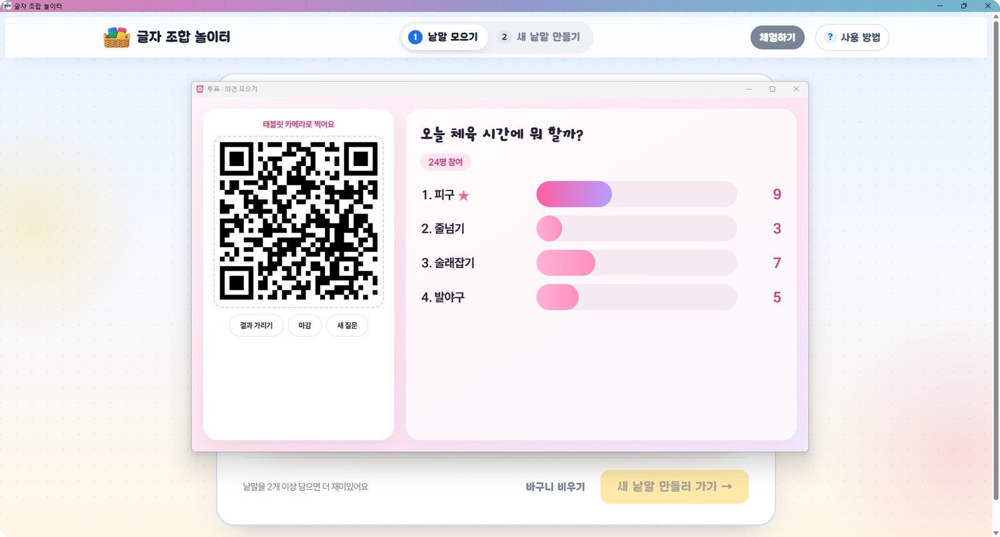 그림 11 · 질문 쓰기 → 골라서 투표 → 의견 모으기

1. 시계 아래 **투표** 버튼을 눌러요.
2. **골라서 투표** 나 **의견 쓰기** 를 고르고 질문을 써요. 보기 예시(좋아요/그저 그래요/별로예요, O/X, 1~4번)를 눌러 바로 채울 수도 있어요.
3. **QR 띄우고 시작** 을 누르면 학생들이 태블릿으로 QR을 찍어 답해요. 앱 설치는 필요 없어요.
4. 결과는 실시간으로 올라와요. **결과 가리기 · 마감 · 새 질문** 버튼이 있고, 의견 쓰기에서는 **의견 뽑기** 로 하나씩 크게 볼 수 있어요.

---

## 10 · 주간 시간표
주간학습안내를 넣으면 그 주 과목으로

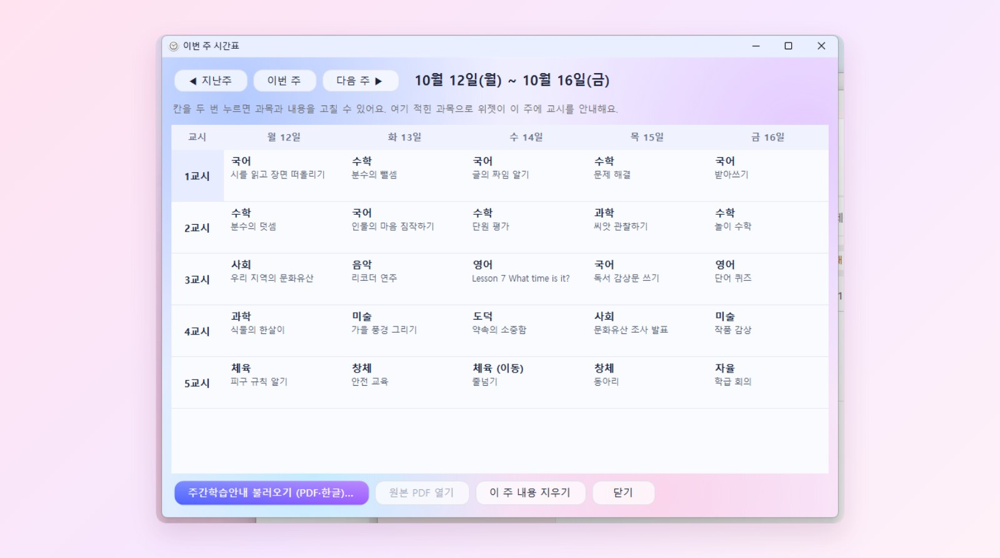 그림 12 · 교실 도구의 ‘이번 주’ (화면의 내용은 예시예요)

1. **이번 주 → 주간학습안내 불러오기 (PDF·한글)…** 를 눌러 그 주 파일을 골라요. 창에 끌어다 놓아도 돼요.
2. 요일 · 교시별 과목과 학습 내용을 읽어 와 표로 보여 줘요. 틀린 칸은 두 번 눌러 고쳐요.
3. 강당 · 과학실처럼 교실을 옮기는 시간은 **이동 수업** 으로 표시하면 5분 전 · 3분 전에 알려 줘요.

> [!NOTE]
> 새 주간학습안내를 넣지 않은 주에는 **지난번에 넣은 시간표를 그대로** 이어서 써요. 스캔한 그림 PDF는 읽지 못해요.

---

## 11 · 텍스트 메모 · 급식
시계 아래에 준비물과 점심 메뉴

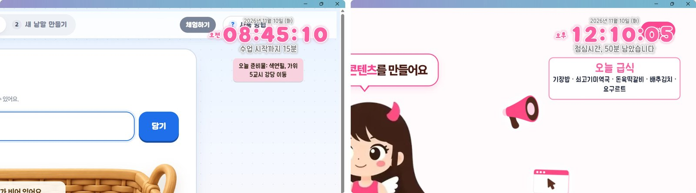 그림 13 · 시계 아래 메모와 오늘 급식

- **텍스트** 버튼을 누르면 시계 아래에 바로 써요. 커서가 굵게 보여 어디에 쓰는지 알기 쉬워요.
- 글꼴 · 크기 · 색 · 배경색을 바꾸고, 일부 글자만 굵게 · 기울임 · 밑줄 · 색으로 꾸밀 수 있어요.
- **급식** 은 처음 한 번 **[우리 학교 찾기]** 로 학교를 정하면 점심 메뉴를 띄워요. 점심시간이 되면 저절로 보여 줘요.

---

## 12 · 생일 축하
생일날 아침에 축하 안내

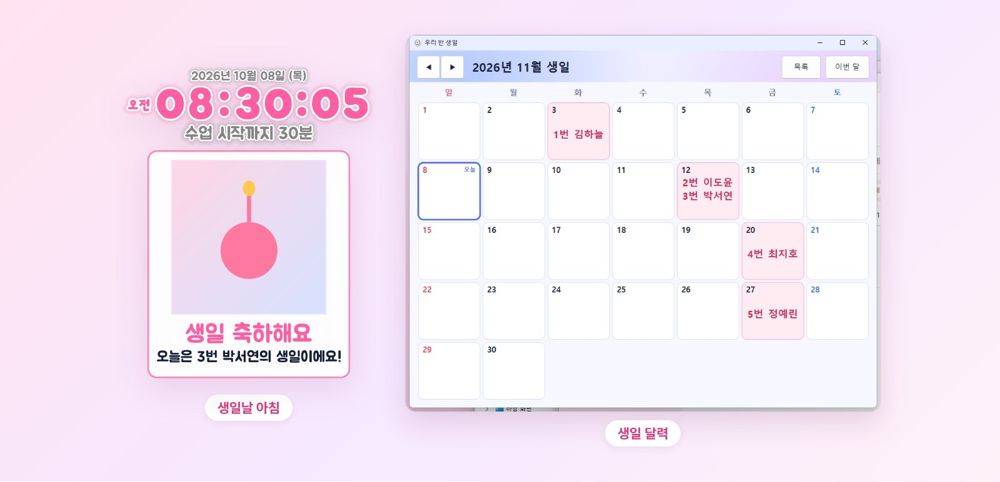 그림 14 · 생일날 아침 안내와 생일 달력 (화면의 이름은 예시예요)

- **설정 → 뽑기 도구 → [생일 명단 넣기…]** 로 엑셀 · 한글 · 글 파일을 넣으면 생일을 알아서 찾아요.
- 생일날 아침에 시계 아래로 축하 안내가 떠요. 학생 사진을 넣었다면 사진도 함께 보여요.
- **[생일 달력]** 에서 한 달 생일을 한눈에 봐요.

---

## 13 · 소음 신호등 · 음악
교실 소리를 눈으로

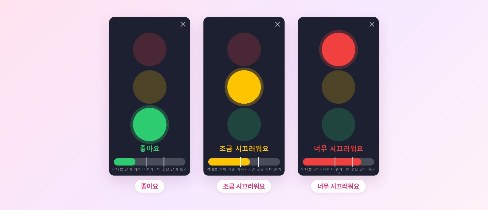 그림 15 · 소음 신호등 — 초록 · 주황 · 빨강

- 컴퓨터 마이크로 교실 소리를 재서 신호등으로 보여 줘요. 막대를 끌어 기준을 우리 반에 맞춰요.
- **음악** 버튼은 유튜브 미니 플레이어를 띄워요. 주소나 재생목록을 넣어 활동 시간 배경 음악으로 써요.

---

## 14 · 디자인 꾸미기
테마 한 번에, 하나씩 다듬기

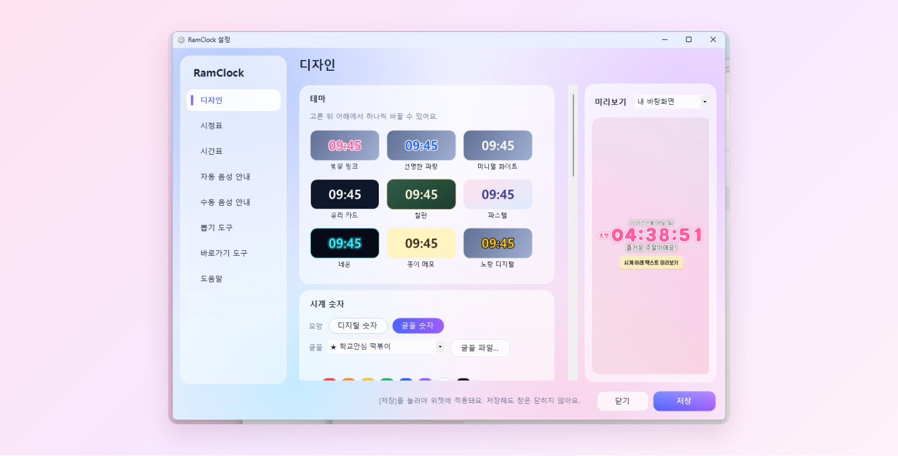 그림 16 · 설정 → 디자인 — 오른쪽은 실제 크기 미리보기

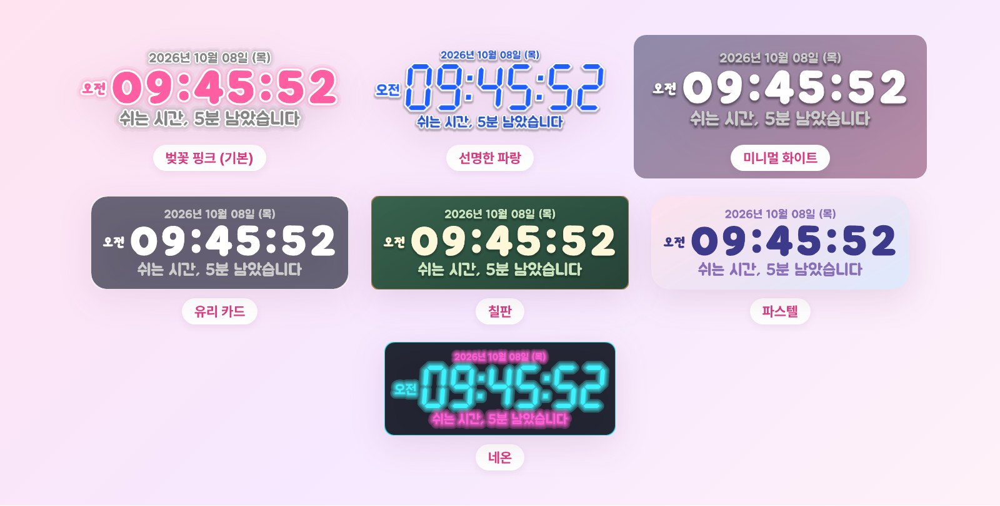 그림 17 · 테마

- 테마를 누르면 색 · 글꼴 · 효과가 한꺼번에 바뀌어요. 그다음 색과 글꼴을 하나씩 다듬어요.
- ★ 표시 글꼴은 프로그램 안에 들어 있어 어느 컴퓨터에서나 똑같이 보여요. 기본은 시계 **학교안심 떡볶이**, 날짜 **주아** 예요.
- 글자 테두리 · 빛남 · 그림자, 배경 투명도, 둥근 모서리, 초 표시를 고를 수 있어요.
- **잠금** 을 켜면 실수로 시계가 옮겨지거나 크기가 바뀌지 않아요.

### 앱 아이콘 고르기

 그림 18 · 앱 아이콘 6가지

**설정 → 디자인 → 기타** 의 **앱 아이콘** 에서 하나를 누르고 **[저장]** 하면 작업 표시줄(트레이) 아이콘, 창 아이콘, 바탕화면 · 시작 메뉴의 RamClock 바로가기 아이콘이 함께 바뀌어요.

---

## 15 · 업데이트 · 바뀐 점
새 버전은 알아서

- 켜 둔 동안 새 버전을 받아 두었다가, 쓰는 창이 없을 때 잠깐 다시 켜지며 바뀌어요.
- 바로 확인하려면 시계를 오른쪽 클릭 → **[업데이트 확인]** 을 눌러요.
- 지금 버전은 **설정 → 도움말** 맨 아래에 있어요.

| 버전 | 바뀐 점 |
|---|---|
| **v1.0.48** | 업데이트 뒤 바로가기·작업 표시줄 아이콘도 새 아이콘으로 |
| v1.0.47 | 새 앱 아이콘, 아이콘 6가지 중 고르기 |
| v1.0.46 | 쉬는 시간 종소리를 학교 종 9가지로 |
| v1.0.44 | 쉬는 시간 시작 알림 |
| v1.0.43 | 받은 파일을 제자리에 설치하고 바로가기 만들기 |
| v1.0.42 | 기본 디자인 ‘벚꽃 핑크’ |
| v1.0.37 | 생일 달력 · 버튼 설명 · 안내 ✕ 버튼 · 시간표 이어 쓰기 |
| v1.0.36 | 생일 · 소음 신호등 · 오늘 급식 · 태블릿 투표 |

버전마다 바뀐 점 전체는 **[CHANGELOG.md](CHANGELOG.md)** 와 [Releases](https://github.com/dpfkadpfka/RamClock/releases)에서 볼 수 있어요.

---

## 16 · 자주 묻는 질문

<b>경고 창이 떠서 실행이 안 돼요</b>

‘파일 열기 - 보안 경고’ 창이면 **[실행]**, 파란 ‘Windows의 PC 보호’ 창이면 **추가 정보 → [실행]** 을 눌러요. [02 · 설치하기](#02--설치하기)를 봐 주세요.

<b>받은 파일 이름이 이상해요 / 다운로드 폴더에서 파일이 사라졌어요</b>

정상이에요. 처음 켤 때 RamClock이 제자리(`내 PC의 프로그램 폴더\RamClock\RamClock.exe`)로 옮겨 가고 다운로드 폴더의 파일은 지워요. 바탕화면의 **RamClock** 바로가기로 켜요.

<b>시계가 안 보여요</b>

작업 표시줄 오른쪽 아래(트레이)의 시계 아이콘을 눌러요. 그래도 없으면 바탕화면 **RamClock** 바로가기로 켜요. 화면 밖으로 나갔다면 설정 → 디자인의 **[크기·위치 처음으로]** 를 눌러요.

<b>안내 목소리가 어색해요</b>

윈도우 설정 → 시간 및 언어 → 음성에서 **한국어 음성** 을 추가해요. 설정 → 자동 음성 안내에서 목소리와 빠르기를 고를 수 있어요.

<b>쉬는 시간 종이 안 울려요</b>

설정 → 자동 음성 안내의 **쉬는 시간 시작 알림** 이 켜져 있는지, 시정표의 수업 끝 시간이 맞는지 확인해요. 컴퓨터 소리가 꺼져 있지 않은지도 봐 주세요.

<b>주간학습안내를 못 읽어요</b>

한글(hwp · hwpx)이나 한글에서 PDF로 저장한 파일은 읽어요. 스캔한 그림 PDF는 읽지 못해요. 읽은 뒤 틀린 칸은 두 번 눌러 고쳐요.

<b>완전히 끄고 싶어요</b>

시계나 트레이 아이콘을 오른쪽 클릭 → **종료**. 매일 자동으로 켜지는 게 싫으면 설정 → 디자인의 **윈도우 켤 때 자동 실행** 을 꺼요.

---

관리자용 · 새 버전 내보내기

1. `CHANGELOG.md` 맨 위에 `## v1.0.X · 제목` 칸을 쓰고 바뀐 점을 적어요.
2. `src/Updater.cs` 의 `Version` 을 같은 번호로 올려 main에 올려요.
3. Actions가 `RamClock.exe` 를 만들어 Releases(vX.Y.Z)에 올리고, CHANGELOG 내용이 릴리스 제목 · 설명이 돼요. 설치된 RamClock은 이걸 보고 자동 업데이트해요.
4. CHANGELOG를 고치면 지난 릴리스 설명도 같이 맞춰져요.

README 그림은 `readme/` 폴더에 있어요. 실제 윈도우에서 화면을 다시 찍으려면 `RamClock.exe` 를 `RamClockShots.exe` 로 이름 바꿔 실행해요 (가짜 명단만 써요).

### 들어 있는 글꼴
나눔고딕 · 나눔손글씨 펜, 주아, 도현, 검은고딕, 해바라기, 개구, 페이퍼로지, 카페24 써라운드, 잘난체, 프리젠테이션, 학교안심(떡볶이 · 둥근미소 · 알림장 · 별자리) — 모두 SIL Open Font License 1.1 글꼴이에요. (`src/fontres/OFL.txt`)

만든 사람 · 부천북초등학교 김예람(예람쌤)

